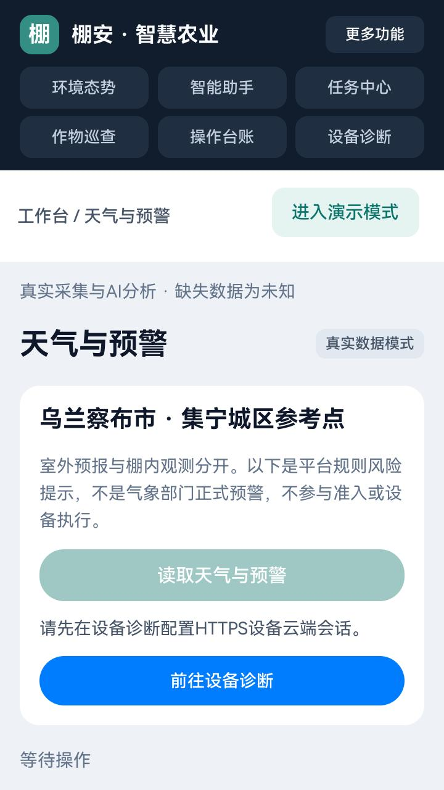

# 棚安 · OpenHarmony 温室监测

HH-HSP101 采集温湿度和 MQ-2 ADC，DAYU200 运行 ArkTS / ArkUI 原生应用，云端提供 Web 管理、历史审计、天气和人工复核建议。天气风险依据乌兰察布参考点预报和项目规则生成。

## 快速部署

使用 Node.js 22 和 Python 3.9 或更新版本。在源码或比赛交付包根目录执行：

```sh
node admin-ui/build.mjs
python setup_cloud.py /etc/pengan
python start_cloud.py --config /etc/pengan/cloud-config.json
```

服务监听回环地址。正式部署需配置可信 HTTPS 反向代理，域名须与初始化时填写的源站一致。Windows 本机演示可执行 `py -3 setup_cloud.py D:/PenganLocal --local`，再使用 `py -3 start_cloud.py --config D:/PenganLocal/cloud-config.json`，浏览器访问 http://127.0.0.1:5201/。初始化目录放在项目之外，首次运行交互设置管理员与设备身份。详见[云端部署](docs/云端部署运行.md)。

## 板端与验收

- `openharmony/` 为 DAYU200 API 26 原生源码，构建方式见 [SDK 迁移记录](docs/OpenHarmony7迁移记录.md)。
- `firmware/hh-hsp101/` 为采集板固件源码，比赛包附 0.1.4 候选固件和未签名 HAP。HAP 须按目标设备签名后安装。
- 本轮交付依据已有 SDK 构建、主机测试和板端开机常亮验证。天气 AI 真实模型与新版固件三端联调仍待验收。详见[验证与限制](docs/原生功能中心与天气AI-20261105.md)。

## 目录

`gateway/` 云服务，`admin-ui/` 管理端，`tests/` 测试，`tools/` 构建与验证工具，`docs/` 部署和交接文档。比赛 ZIP 包含源码、交付候选和 SHA256 清单。

## 运行截图

DAYU200 原生天气页，SDK 预览（720 × 1280）。


