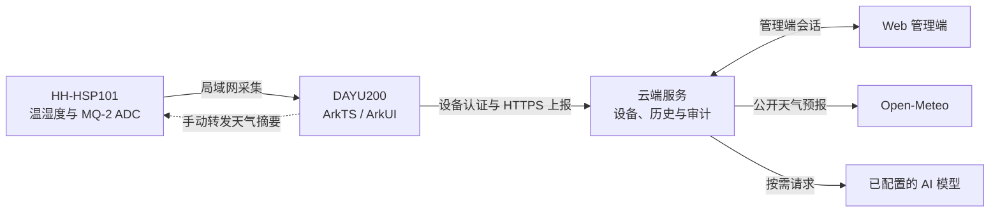

<div align="center">

# 🌱 棚安 · Pengan

**面向温室巡检的 OpenHarmony 端云协同系统**

`DAYU200 · ArkTS / ArkUI`  `HH-HSP101`  `Node.js · Web 管理端`

[运行截图](#运行截图) · [系统架构](#系统架构) · [快速运行](#快速运行) · [比赛交付](#比赛交付)

</div>

棚安把棚内监测、室外天气和人工巡检串在一起。采集板提供现场读数，DAYU200 展示设备状态，云端汇总历史与审计。值班人员可以结合天气风险生成有依据的农事检查建议，再到现场核对。

## 运行截图

<p align="center"></p>

<div align="center">官方 SDK 运行预览 · 720 × 1280 · 天气与预警页面</div>

## 系统架构



| 场景 | 评委可以查看 |
| --- | --- |
| 现场监测 | 温湿度、ADC 原始读数、采集状态及历史。数据过期显示未知。 |
| 天气巡检 | 集宁城区参考点的室外预报、低温和阵风等规则风险，以及建议的天气依据。 |
| 人工复核 | 作物巡查、待复核标记、历史记录和审计线索。 |
| 设备协作 | 原生上报、云端设备隔离，以及手动将天气摘要转发至 HSP 屏幕。 |

天气风险来自项目规则。AI 建议供人工巡检参考，建议结果进入审计记录。

## 快速运行

需要 Node.js 22.13+ 和 Python 3.9+。在项目根目录执行：

```sh
node admin-ui/build.mjs
python setup_cloud.py /etc/pengan
python start_cloud.py --config /etc/pengan/cloud-config.json
```

正式部署通过可信 HTTPS 反向代理提供服务，并使用初始化时填写的源站地址。Windows 本机可用 `py -3 setup_cloud.py D:/PenganLocal --local` 初始化，再用 `py -3 start_cloud.py --config D:/PenganLocal/cloud-config.json` 启动，打开 `http://127.0.0.1:5201/`。首次初始化时交互设置管理员和设备身份。[完整部署说明](docs/云端部署运行.md)

| 目录 | 内容 |
| --- | --- |
| `openharmony/` | DAYU200 API 26 原生应用 |
| `firmware/hh-hsp101/` | 采集板固件 |
| `gateway/` · `admin-ui/` | 云服务和 Web 管理端 |
| `tests/` · `tools/` · `docs/` | 测试、构建工具和文档 |

## 比赛交付

比赛 ZIP 包含源码、部署说明、运行截图、HH-HSP101 0.1.4 候选固件、未签名 HAP 及 SHA256 校验清单。HAP 安装前须按目标设备签名。[原生构建说明](docs/OpenHarmony7迁移记录.md)

已有 SDK 构建、主机测试和板端开机常亮验证。新版三端实物联调与天气 AI 真实模型验收仍待完成。[验证记录](docs/原生功能中心与天气AI-20261105.md)
