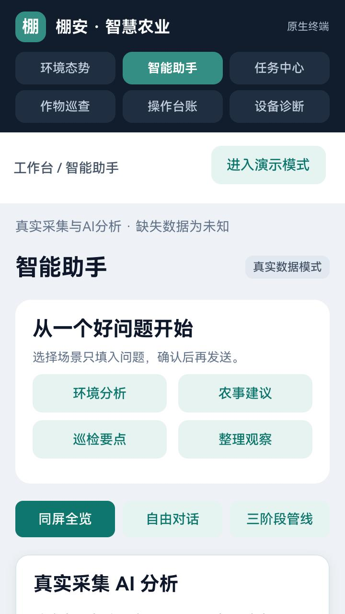
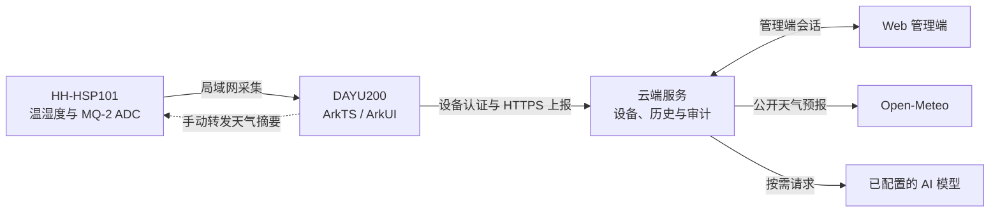

<div align="center">

# 🌱 棚安 · OpenHarmony AI Agent

**面向温室巡检的 OpenHarmony 原生 AI Agent**

`DAYU200 · ArkTS / ArkUI`  `HH-HSP101`  `Node.js · Web 管理端`

[Agent 工作流](#agent-工作流) · [运行截图](#运行截图) · [系统架构](#系统架构) · [快速运行](#快速运行) · [比赛交付](#比赛交付)

</div>

巡检人员在 DAYU200 原生 ArkUI 应用里提出问题。云端 Agent 按需调用只读工具查询当前环境和历史观测，返回发现、缺失信息与人工复核建议。HH-HSP101 提供现场观测，Web 管理端用于查看历史与审计。

## Agent 工作流

1. **原生提问** · 在 OpenHarmony 助手中询问棚内环境变化或需要优先检查的事项。
2. **工具取证** · Agent 可调用 `read_environment` 查询当前温湿度和 ADC 观测，或调用 `read_recent_history` 读取近期历史。设备离线或数据失效时保留未知状态。
3. **结构化建议** · Agent 通过 `analyze_observations` 返回摘要、发现与未知项。天气页另有基于室外预报的农事建议入口。
4. **人工复核与审计** · 值班人员按建议核查现场。天气建议保存预报依据、模型与记录编号，便于追溯。

OpenHarmony 原生端承载提问、结果展示与设备协作，模型推理和工具编排由云端服务完成。真实模式的工具为只读，建议由人员复核。

## 运行截图

<p align="center"></p>

<div align="center">官方 SDK 运行预览 · 原生 AI 助手与天气预警 · 720 × 1280</div>

## 系统架构



| 场景 | 评委可以查看 |
| --- | --- |
| 现场监测 | 温湿度、ADC 原始读数、采集状态及历史。数据过期显示未知。 |
| 天气巡检 | 集宁城区参考点的室外预报、低温和阵风等规则风险，以及建议的天气依据。 |
| 人工复核 | 作物巡查、待复核标记、历史记录和审计线索。 |
| 设备协作 | 原生上报、云端设备隔离，以及手动将天气摘要转发至 HSP 屏幕。 |

天气风险来自项目规则。AI 建议供人工巡检参考，建议结果进入审计记录。

## 快速运行

需要 Node.js 22.13+ 和 Python 3.9+。在项目根目录执行：

```sh
node admin-ui/build.mjs
python setup_cloud.py /etc/pengan
python start_cloud.py --config /etc/pengan/cloud-config.json
```

正式部署通过可信 HTTPS 反向代理提供服务，并使用初始化时填写的源站地址。Windows 本机可用 `py -3 setup_cloud.py D:/PenganLocal --local` 初始化，再用 `py -3 start_cloud.py --config D:/PenganLocal/cloud-config.json` 启动，打开 `http://127.0.0.1:5201/`。首次初始化时交互设置管理员和设备身份。[完整部署说明](docs/云端部署运行.md)

| 目录 | 内容 |
| --- | --- |
| `openharmony/` | DAYU200 API 26 原生应用 |
| `firmware/hh-hsp101/` | 采集板固件 |
| `gateway/` · `admin-ui/` | 云服务和 Web 管理端 |
| `tests/` · `tools/` · `docs/` | 测试、构建工具和文档 |

## 比赛交付

[下载比赛 ZIP](https://github.com/missliou/pengan/releases/tag/v0.1.0)。包内包含源码、部署说明、运行截图、HH-HSP101 0.1.4 候选固件、未签名 HAP 及 SHA256 校验清单。HAP 安装前须按目标设备签名。[原生构建说明](docs/OpenHarmony7迁移记录.md)

已有 SDK 构建、主机测试和板端开机常亮验证。新版三端实物联调与天气 AI 真实模型验收仍待完成。[验证记录](docs/原生功能中心与天气AI-20261105.md)
